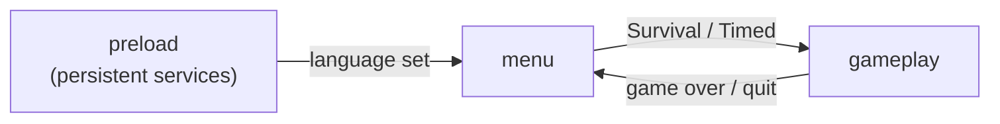
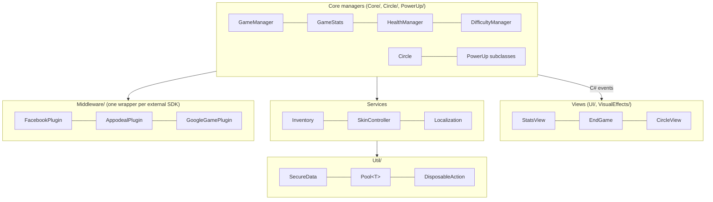

# Bubbit

> A fast, physics-driven arcade puzzle game for mobile. I made it solo: code, game design and art. Now it's being revived in Unity 6.

   

---

## Play it

▶️ **[Play Bubbit in your browser](https://lebasp.github.io/bubbit-web/)**

---

## What is Bubbit?

Bubbles float around the screen and you **grab them by connecting a line to them**. While connected, a bubble slows down and follows your finger. Then you can:

- **Merge** two bubbles to add their points together and raise your score.
- **Avoid skull bubbles.** Touching one costs a heart. Two skulls can collide safely.
- **Pop special bubbles** to trigger power-ups: *Slow*, *Frost*, *Black Hole*, *Double Points*, *Extra Life* and *Extra Time*.
- **Throw bubbles off the sides** of the screen to discard them.
- **Build a bubble worth more than 10 points** and it clears the board.

There are two modes:

| Mode | Goal |
|---|---|
| **Survival** | Keep your hearts as difficulty levels ramp up. |
| **Timed** | Score as much as possible before the clock runs out. Power-ups can add time. |

Coins are earned at the end of every match. They are spent on cosmetics (10 background colors and 4 bubble shapes) and on reviving after a game over.

---

## Timeline

| When | What happened |
|---|---|
| **2015 to 2016** | I designed and built Bubbit **entirely on my own**: game design, all C# code, art and UI. It was released on **Google Play** and the **App Store**. |
| **2016 to 2017** | Live updates (Unity 5.5): a cosmetics store, Game Center and Google Play achievements and leaderboards, Facebook friends' scores, push notifications, a tutorial, and a new main menu. |
| **2018** | I upgraded the project to Unity 2018.2 just before joining the industry full time. That upgrade was never finished. |
| **2024** | The game was **removed from the stores**. The ad, IAP and backend SDKs it depended on had become obsolete. |
| **2026** | **Revival.** I'm bringing Bubbit back to life: updated to **Unity 6**, turned into a **premium game** (no ads, no in-app purchases), with the goal of returning to the stores. I'm doing this work with AI pair-programming (Anthropic's **Claude**). |

---

## Architecture

The code lives in `Assets/_Scripts` (about 95 C# files). It follows a small set of conventions that are applied consistently across the project.

### Scene flow



- **`preload`** creates the objects that live across scenes with `DontDestroyOnLoad`: `TransitionEffect`, `BackgroundController`, `SkinController`, `SoundManager` and `PopupController`. An editor script (`Editor/PlayFromPreload.cs`) makes every Play session start from this scene.
- **`menu`** holds the main menu and its overlays: options, customization, tutorial and leaderboards.
- **`gameplay`** holds a single match. `SceneController.GameKind` tells it which mode to run.

### Layers



### Key patterns

| Pattern | Where | Why |
|---|---|---|
| **Event-driven views** | Managers expose delegates (`onScoreChanged`, `onLifeChanged`, `OnGamePausedEvent`...). Views subscribe in `Start` and unsubscribe in `OnDestroy`. | Game rules never touch the UI directly. |
| **Logic / view split** | `Circle` owns state and rules and raises `OnStateChanged`, `OnPointsChanged` and `OnShake`. `CircleView` only reacts with sprites and animation. | You can change the visuals without touching gameplay. |
| **Adapter per third-party SDK** | Each SDK sits behind a `Middleware/XxxPlugin`. Nothing else talks to an SDK directly. | Swapping or removing a vendor is a one-file change. This paid off in 2026: every dead SDK was switched off by stubbing its wrapper, with no change to gameplay code. |
| **Lifetime-safe callbacks** | `DisposableAction` (`this.addAction(...)`) ties an async callback to the GameObject that requested it. | A late SDK or network response can't call into a destroyed object. |
| **Pause-aware timing** | Timed systems (spawner, difficulty, timer, power-ups) run in coroutines and listen to `OnGamePausedEvent`. | Pausing freezes every system consistently. |
| **Object pooling** | Generic `Pool<T>` for bubbles, background bubbles, floating score text and leaderboard cards. | Avoids GC spikes on mobile. |
| **Save system** | All persistent data goes through `SecureData`, which encrypts values before writing them to PlayerPrefs. Its passphrase comes from a git-ignored config file. Every key is declared once in `SaveKeys`. | Save data can't be edited by hand on the device, and there are no scattered string keys. |
| **Localization system** | Each language implements `ILanguage` as a key→text dictionary (English and Brazilian Portuguese). Code asks `Localization.CurrentLanguage.GetString(key)`; a `Localize` component on UI texts refreshes itself through the `onLanguageChanged` event. | Adding a language is one new class, and switching language updates the whole UI at runtime. |

### Folder map

```
Assets/_Scripts
├── Core/           game state managers (GameManager, GameStats, HealthManager, DifficultyManager, Inventory, SkinController...)
├── Circle/         bubble logic, view, spawner, collision
├── PowerUp/        PowerUp base class + one subclass per effect
├── UI/             screens and widgets
├── Middleware/     one adapter per external SDK
├── Localization/   ILanguage + English / Portuguese
├── Background/     animated background
├── VisualEffects/  DOTween-based reusable animations
├── Tutorial/       ITutorialStep-based tutorial
├── Util/           Pool<T>, SecureData, SaveKeys, DisposableAction...
└── Editor/         editor tooling
```

---

## 2026 revival

**Done**
- Migrated from Unity 2018.2 to **Unity 6** and fixed the API breaks (`DtdProcessing`, `SceneManager`, scene enumeration).
- Converted the scenes to text serialization so they diff cleanly in git.
- **Recovered the gameplay scene from version control.** The 2018 copy turned out to be an older layout that was missing the coin, sound and screenshot UI. I restored the last committed version, using UnityPy to read and compare the binary scenes.
- Replaced the **Soomla** store SDK with a local `Inventory` (same item IDs and prices). The coin economy, cosmetics and revive work offline again.
- **Premium conversion:** removed ads, real-money IAP and rewarded video.
- Switched off every dead third-party SDK (Appodeal, Facebook, OneSignal, App42, Google Play Games, Everyplay, NativeShare) behind its existing adapter. Each one is marked `//[MIGRATION] TODO`.
- Blanked the hardcoded SDK keys in the scripts. This repository starts with fresh history.
- Moved the `SecureData` passphrase out of the source code into a git-ignored config file. The passphrase visible in early commits was temporary and will be replaced in the published version.

**Next**
- Typed item IDs (`enum`) and a data-driven cosmetics catalog (`ScriptableObject`) to replace string IDs and `if` chains.
- Delete the stubbed SDK folders and replace the legacy leaderboard with a modern backend or platform services.
- Unit tests for the pure-logic classes (`Inventory`, scoring, difficulty curve).
- Ship back to Google Play and the App Store as a premium title.

---

## Running it

1. Open the project in **Unity 6000.5** or newer.
2. Create the save config: copy `Config/SecureDataConfig.example.json` to `Assets/Resources/SecureDataConfig.json` and set your own passphrase. The file is git-ignored. Without it the game still runs, using a development-only passphrase, and logs a warning explaining this step.
3. Open `Assets/Scene/preload.unity`, or just press Play from any scene: `PlayFromPreload` redirects it.
4. Build targets: Android, iOS and WebGL.

---

## Credits

**Leandro Serafim**: game design, programming, art and UI.

Third-party: [DOTween](http://dotween.demigiant.com/) by Demigiant, plus the pixel fonts in `Assets/Fonts`, which belong to their respective authors.
